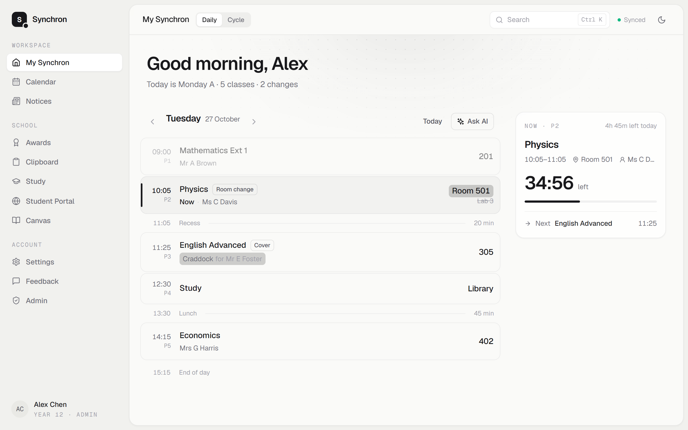
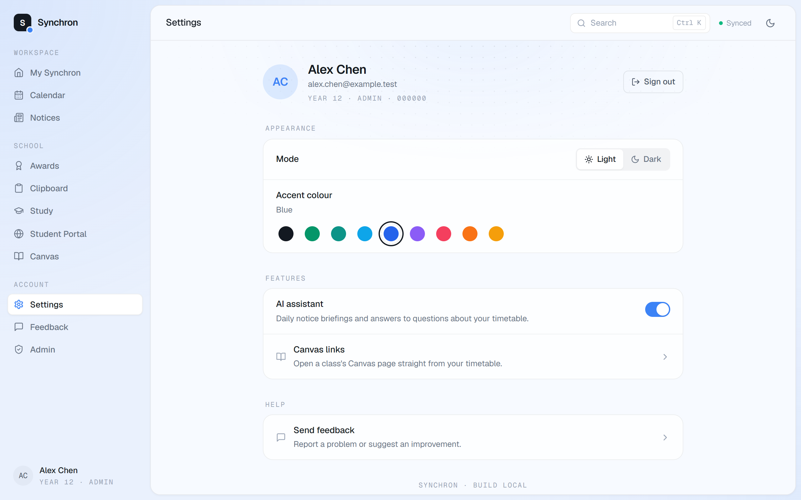
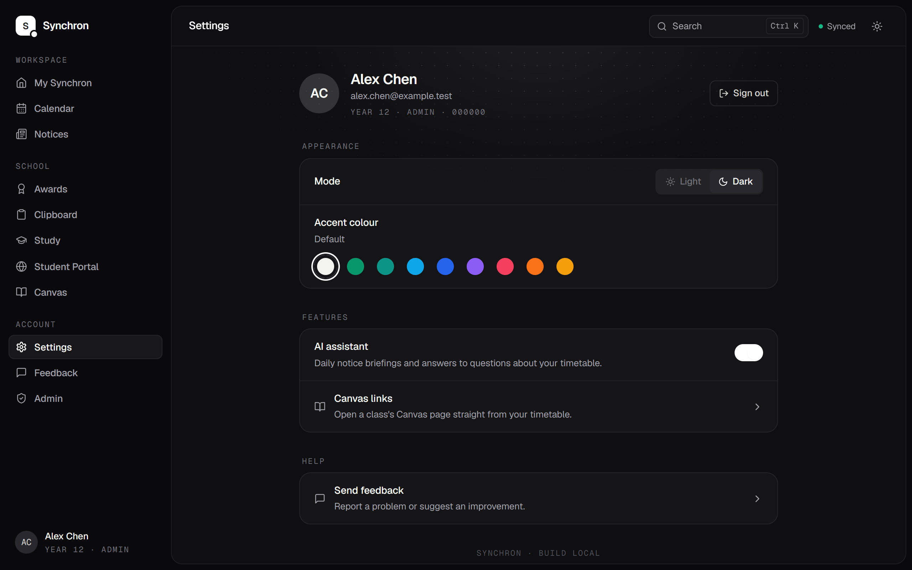
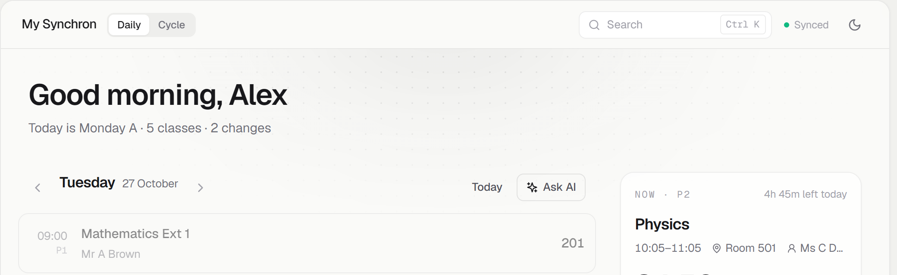
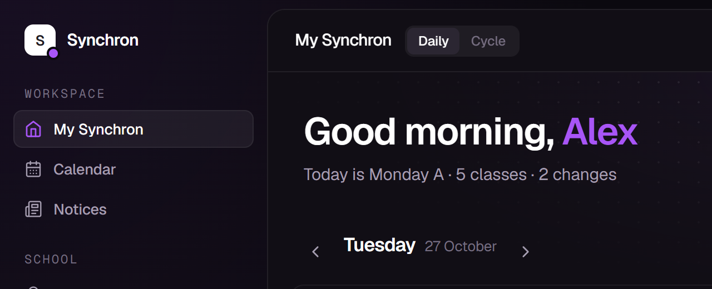
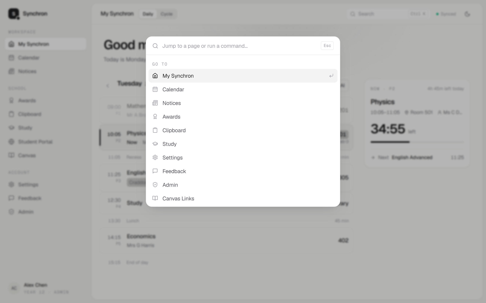
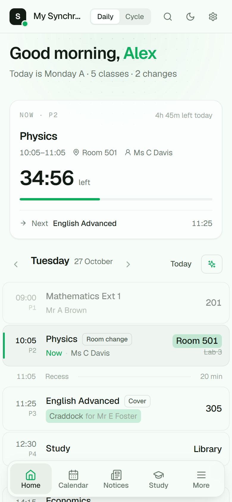

# Synchron Design Language

Synchron has one shell: Modern. The Classic (brutalist, square-edged) interface has been removed. The staging Paper
look is an optional appearance experiment within that shell; the original Synchron look remains available in
Settings. See [Classic removal](#classic-removal) for what changed.

Modern is calm, soft and quick. It should feel like a well-made desktop tool, not a poster: neutral surfaces in
layers, one accent colour used sparingly, small exact type, and motion that confirms what happened without
drawing attention to itself.

---

## Principles

Screenshots are from the local dev build with sample data (`client/src/services/mockData.js`), with the clock set
to 10:30 so a period is live. Images live in [`docs/design/`](docs/design/).

### 1. Content first, chrome second

The timetable and the notices are what students came for. Shell elements (sidebar, topbar, dock) use muted
neutrals and stay out of the way.



*The timetable and the live "Now" card carry all the contrast. Past periods dim, and the sidebar is grey text on
the page surface.*

### 2. One accent, used for meaning

The accent marks *where you are* and *what's live*: the active nav icon, focus rings, the current period,
selection. It is never decoration on its own.



*With the blue accent, colour appears only on the active Settings icon, the selected swatch, the "on" switch, the
avatar initials and the brand-mark dot. Everything else stays neutral, apart from a faint ambient wash.*

### 3. Depth through layers, not lines

Separate regions with surface steps (page → panel → card) and soft shadows. Borders are hairlines at 7–8% opacity,
never solid black or white.



*Dark mode is three graphite steps: `m-page` behind the sidebar, `m-panel` for the main area, and `m-card` for the
grouped rows. It never goes pure black, and every edge is a 7% white hairline.*

### 4. Quiet type

Medium and semibold weights, tight tracking on large sizes. Nothing heavier than 650.



*Geist throughout. The greeting is semibold with −0.03em tracking, and secondary text drops to zinc-500 rather than a
lighter weight. The mono eyebrow ("NOW · P2") marks metadata.*

### 5. Motion confirms

Springs for state changes, short fades for overlays. Respect `prefers-reduced-motion` every time.



*The active nav pill and the Daily/Cycle segment are one element each that springs between positions
(`stiffness 500, damping 40`). Nothing animates without a state change behind it.*

### 6. Keyboard-complete

Every destination can be reached from the command palette (`Ctrl/⌘ K`).



*`Ctrl/⌘ K` opens the palette over a soft scrim. Every page, external link and global action is listed, and arrow
keys plus Enter are all you need.*

#### On small screens



*Below `md` the sidebar becomes a floating dock, and "More" opens the same command palette.*

---

## Foundations

Everything is driven by CSS variables so colour themes and dark mode retune the whole app without touching
component classes. Sources of truth:

| File | Owns |
| --- | --- |
| `client/src/index.css` | Base neutral scale, accent variables, fonts |
| `client/src/theme/modern.css` | Modern surfaces, typography/radius retuning, focus, scrollbars, tile spotlight |
| `client/src/theme/colorThemes.css` | Per-accent tinting of neutrals and surfaces (generated), ambient glow |
| `client/tailwind.config.js` | Maps the variables to Tailwind (`zinc-*`, `m-*`, `accent`) |

### Surfaces

Three layers, from back to front. Always use the `m-*` tokens for shell and container backgrounds, not
`bg-zinc-50` / `bg-black`.

| Token | Tailwind | Light | Dark | Use |
| --- | --- | --- | --- | --- |
| `--m-page` | `bg-m-page` | warm paper `241 241 238` | `10 10 12` | App background behind the sidebar and main panel |
| `--m-panel` | `bg-m-panel` | `250 250 248` | `15 15 18` | Main content panel, topbar, dock (often at `/75` with `backdrop-blur-xl`) |
| `--m-card` | `bg-m-card` | `255 255 255` | `21 21 25` | Cards, inputs, palette, popovers |
| `--m-line` | `border-m-line` | zinc-900 @ 8% | white @ 7% | Every hairline border and divider |

Dark mode is **layered graphite, never pure black**. The darkest surface is `10 10 12`.

### Neutrals

Use the `zinc` scale for text and icons. It is variable-driven: colour themes tint it toward the accent hue in
OKLCH without changing lightness, so contrast holds in every theme. Half-steps (`zinc-150` … `zinc-850`) exist and
are mixed from their neighbours.

| Role | Light | Dark |
| --- | --- | --- |
| Primary text | `text-zinc-900` | `dark:text-white` / `dark:text-zinc-100` |
| Secondary text | `text-zinc-500` | `dark:text-zinc-400` |
| Tertiary / labels / placeholders | `text-zinc-400` | `dark:text-zinc-500` |
| Hover wash | `bg-zinc-900/[0.04]` | `dark:bg-white/[0.04]` |
| Pressed / selected wash | `bg-zinc-900/[0.05–0.06]` | `dark:bg-white/[0.06–0.08]` |

Prefer these translucent washes over solid grey fills for hover and selection, since they sit correctly on
any surface.

### Accent

`accent` / `accent-contrast` come from `--color-accent` (HSL). The default is monochrome (zinc-900 in light, white
in dark). Colour themes: `mint`, `amber`, `blue`, `violet`, `rose`, `teal`, `orange`, `sky`.

Use the accent for:
- the active nav or dock icon (`text-accent`), not the whole row
- focus rings: `0 0 0 3px hsl(var(--color-accent) / 0.18)` with a 60% accent border
- the current or live item (current period, today)
- text selection (`bg-accent text-accent-contrast`)
- primary buttons (`bg-accent text-accent-contrast`)
- ambient glows (`.m-ambient`, `.m-dots`, tile spotlight), always at ≤ 10% alpha

Don't use it for large filled regions, body text, or more than one call-to-action per view.

**Status colours** are fixed and separate from the accent: `emerald-500` synced, `sky-500` cached,
`amber-500` offline/warning, `rose-500` error. Show them as a 6px dot (`w-1.5 h-1.5 rounded-full`) next to a
label, not as filled banners.

### Typography

| Variable | Family | Use |
| --- | --- | --- |
| `--font-sans` | Geist (Inter fallback) | Everything by default |
| `--font-display` | Geist | Headlines (`font-space`) |
| `--font-mono` | Geist Mono (JetBrains Mono fallback) | Eyebrows, kbd hints, times, codes, initials |

Body has `letter-spacing: -0.005em`, `ss01` + `cv11` features, and antialiasing.

**Scale.** Interface type is small and exact. Use these sizes and nothing in between:

| Size | Use |
| --- | --- |
| `text-[11px]` mono, uppercase, `tracking-[0.12–0.14em]` | Eyebrows, group labels, metadata, `kbd` |
| `text-[12px]` | Dock labels, captions |
| `text-[13px]` / `text-[13.5px]` | Nav items, inputs, dense lists |
| `text-sm` (14px) | Body, palette rows |
| `text-[15px]` medium | Topbar title, brand, card titles |
| `text-xl`–`text-2xl` | Section headings (tracking −0.02em) |
| `text-3xl`+ | Page hero / dashboard numerals (tracking −0.03em) |

**Overall scale.** On bigger screens the whole interface is drawn larger than these CSS sizes, so it stays soft and
roomy instead of tiny: `--ui-scale` in `modern.css` zooms the body, stepping with the window (both width and height
must clear each step). Phones, tablets and small laptops stay at 1; 1280×760 gets 1.04, 1440×820 1.08, 1680×940
1.14, 1920×1040 1.2 and 2400×1300 1.32. Full-height frames
(`h-[100dvh]`, `min-h-[100dvh]` and the `calc(100dvh…)` panels) are divided by the same factor so they still fill the
window exactly. If you add another viewport-height frame, give it the same compensation there.

**Weights.** 400 body, 500 (`font-medium`) for UI labels, 600 (`font-semibold`) for headings. `font-black` is
capped at 650 and `font-extrabold` at 600. Don't reach for heavier.

**Eyebrow pattern** (group headers, section kickers):

```jsx
<div className="font-mono text-[11px] uppercase tracking-[0.14em] text-zinc-400 dark:text-zinc-500">Workspace</div>
```

### Radii

| Radius | Use |
| --- | --- |
| `rounded-md` (6px) | Segments inside a segmented control |
| `rounded-lg` (8px) / 10px | Buttons, inputs, nav rows, icon buttons, small bordered boxes |
| `rounded-xl` (12px) | Dock items, profile chip, list cards |
| `rounded-2xl` (16px) | Cards with `p-5`+, main panel, dock, command palette, modals |
| `rounded-full` | Avatars, status dots, pills |

Nested corners get smaller as they go inward: a `rounded-2xl` container with `p-1` holds `rounded-xl` children.

### Elevation

| Token | Use |
| --- | --- |
| `var(--m-shadow)` | Resting cards (applied automatically to padded bordered cards). In dark mode, a 3% inner top highlight |
| `.m-shadow-lg` / `var(--m-shadow-lg)` | Floating layers: command palette, dock, popovers, modals |
| `shadow-[0_1px_2px_rgb(0_0_0/0.05)]` | Active pill in the sidebar and segmented controls |

Overlays use a scrim of `bg-zinc-950/30 dark:bg-black/60 backdrop-blur-[2px]`.

### Spacing & layout

- 4px grid. Common rhythm: `gap-1.5` / `gap-2.5` inside controls, `gap-3` between controls, `space-y-5` between nav
  groups, `p-4 md:p-8` around page content.
- Content max width `max-w-7xl mx-auto`. Leave `pb-28` on mobile so the dock never covers content.
- Heights: topbar `h-14`, controls `h-8`, palette input `h-12`, dock items `h-[52px]`.

### Iconography

[lucide-react](https://lucide.dev) only. 16px in nav, buttons and the topbar, 19px in the dock, 13–15px inline
with text. Stroke 1.8 at rest and 2.1 when active. Icons inherit `currentColor`; only the active icon picks up
`text-accent`.

---

## Shell

Defined in `client/src/components/modern/ModernShell.jsx`.

```
┌──────────┬─────────────────────────────────────────────┐
│ Sidebar  │  Topbar (sticky, h-14, panel/80 + blur)     │
│ w-60     ├─────────────────────────────────────────────┤
│ on       │  .m-dots header glow                        │
│ m-page   │  Content  (p-4 md:p-8, max-w-7xl)           │
│          │                                             │
│ Profile  │  main panel: bg-m-panel, rounded-2xl,       │
│ chip     │  border-m-line, inset 8px from the window   │
└──────────┴─────────────────────────────────────────────┘
        mobile: sidebar hidden → floating dock at bottom
```

- **Sidebar** (`md+`): brand mark, nav grouped as *Workspace*, *School* and *Account* under mono eyebrows, profile
  chip at the bottom. The active row is a white (dark: `white/6%`) pill with a hairline border that slides between
  items via `layoutId="m-nav-active"`. External links show an `ArrowUpRight` on hover and never take the active
  state.
- **Topbar**: page title (15px medium), view-specific controls (e.g. the Daily/Cycle segmented control), a search
  field that opens the palette, a sync status dot, and the theme toggle.
- **Dock** (`< md`): floating, `max-w-md`, `rounded-2xl`, blurred panel with `.m-shadow-lg`, respects
  `safe-area-inset-bottom`. Four primary views plus *More*, which opens the command palette.
- **Command palette**: `Ctrl/⌘ K`, `max-w-lg`, 12vh from the top. Groups are *Go to*, *Links*, *Actions* and
  *Account*. Arrow keys move, Enter runs, Esc closes. Any new page or global action must register a command in
  `buildCommands`.
- **Brand mark**: a 28px rounded square in zinc-900 (dark: white) with an "S", plus an accent dot at the corner
  ringed in `m-page`.

### The exceptions: Study and Clipboard

The Study page promotes NoteFlow, a separate app, so its content is drawn in **NoteFlow's** design language (ink on
warm paper, Instrument Sans and Serif, one violet highlighter swipe, a red pen for results) inside the Modern shell.
Its tokens are scoped to `.nf` in `client/src/components/study/noteflow.css`, and Synchron's accent never reaches it.
Keep NoteFlow's rules there (no uppercase eyebrows, one swipe at a time, motion that plays once).

**Clipboard** is drawn in the same language (`client/src/components/clipboard/`, styles in `clipboard.css`). Its
main tab is a month calendar on one sheet: today carries the swipe, the chosen day is listed underneath as ruled
rows, and any session pops out with its time, location (with a map), opponent and notes. The red pen only rings a
match result. On the home timetable a session is **one line**, laid out like a break row (time, violet dot, name,
hairline, place), never a card, and students can turn it off in Settings. Don't use `.nf` outside Study and Clipboard.

---

## Components

### Buttons

| Variant | Classes |
| --- | --- |
| Primary | `h-8 px-3 rounded-lg bg-accent text-accent-contrast text-[13px] font-medium hover:opacity-90` |
| Secondary | `h-8 px-3 rounded-lg border border-m-line bg-m-card text-zinc-700 dark:text-zinc-200 hover:bg-zinc-900/[0.03]` |
| Ghost / icon | `w-8 h-8 grid place-items-center rounded-lg text-zinc-500 hover:text-zinc-900 hover:bg-zinc-900/[0.05] dark:hover:text-white dark:hover:bg-white/[0.06]` |

Focus: `outline: 2px solid hsl(var(--color-accent) / 0.5); outline-offset: 2px` (global in `modern.css`).

### Segmented control

Track `p-0.5 rounded-lg bg-zinc-900/[0.05] dark:bg-white/[0.06]`. The selected segment is a `rounded-md
bg-white dark:bg-zinc-800 shadow-sm` pill that slides with a shared `layoutId`.

### Inputs

`rounded-lg border border-m-line bg-m-card text-[13px]`, placeholder `text-zinc-400`. Focus is handled globally:
a soft accent ring with an accent border. Add `data-bare` to opt out (e.g. the palette input).

### Cards & tiles

`rounded-2xl border border-m-line bg-m-card p-5` with `--m-shadow`. Dashboard tiles go in `.relative-tile-wrapper`
to get the pointer-tracked spotlight and glowing edge on hover (`useModernShellEffects` feeds `--mx` / `--my`).
One heading, one primary number or list, at most one action per tile.

### Keyboard hints

`<kbd className="font-mono text-[11px] px-1.5 py-0.5 rounded border border-m-line text-zinc-400">`

### Empty & loading states

Centred, `py-10 text-sm text-zinc-400`, one sentence, written in plain words ("No results for “maths”").
Skeletons use `bg-zinc-900/[0.05] dark:bg-white/[0.06]` with `animate-pulse-subtle`.

---

## Motion

| Interaction | Spec |
| --- | --- |
| Shared-layout indicators (nav pill, dock, segmented) | `type: 'spring', stiffness: 500, damping: 40` |
| Dialogs / palette panel | spring `stiffness: 500, damping: 36`; from `opacity 0, y -8, scale 0.98` |
| Scrims and fades | `duration: 0.15` |
| Icon swaps (theme toggle) | rotate ±90°, scale 0.6 → 1, `0.18s`, `AnimatePresence mode="wait"` |
| Hover colour | Tailwind `transition-colors` (150ms) |
| Tile lift / glow | `300ms cubic-bezier(0.2, 0.8, 0.2, 1)` |
| Page entrance | `animate-in fade-in slide-in-from-bottom-2` (tailwindcss-animate) |
| Changing view | `App.jsx`: cross-fade with an 8px lift in (`0.2s`), out in `0.07s`. Opacity and transform only: no blur on whole pages, it stutters |
| Press | global in `modern.css`: everything pressable dips to `--press-scale` (`.96`, `.98` for wide targets) in 90ms, then springs back past rest (`520ms cubic-bezier(.34,1.56,.64,1)`). Uses the `scale` property so it composes with framer-motion. Opt out with `data-no-press`; make a non-button pressable with `.press` |
| Countdown digits | roll like an odometer, each digit a spring (`stiffness 380, damping 30`) |

**The bell.** When a period changes, it's an event worth seeing once: the new class row pulses in its subject colour
(`.period-start`) and its colour stripe swells (`.period-stripe`), the finished one fades back over 700ms, and the Now
card's sheen sweeps across as the new class rises in. Opening the app or browsing days never counts as a bell.

**Ambient light** (`components/modern/AmbientLight.jsx`) is the one deliberate exception to "glows stay at 10%
or less". Three drifting glows follow the time of day, from dawn pinks to midday sky to sunset violets and night
blues, blending between keyframes. It's noticeable on purpose, at 62% opacity in light mode and 38% in dark, and
students can turn it off in Settings. The live class's card is likewise washed in its subject colour
(`.subject-wash`).

Under `prefers-reduced-motion: reduce`, animations and transitions are cut to near zero globally, ambient drift and
the bell pulse stop entirely, and blurs are dropped. Don't bypass this with inline styles.

---

## Landing page

`client/src/components/LandingPage.jsx` is what signed-out visitors see. It is always dark and, unlike the app,
scrolls as an ordinary document (no inset panel, no inner scroll area).

- **Hero:** the headline, one primary "Sign in with SBHS" button, and a miniature of the real home page. The miniature
  eases back slightly as you scroll away.
- **The day:** a Tuesday told as five chapters (before school, a substitute and room change, the countdown, Clipboard at
  lunch, tomorrow saved offline). A sticky clock rolls from 8:00 to 15:20 as you scroll, the day's rail beside it dims
  what's past and marks what's on like the timetable does, and the ambient light follows that clock instead of the real
  one. Each chapter's time is reached when its middle crosses a reading line at 60% of the viewport. This is measured
  with `getBoundingClientRect`, not framer's `useScroll({ target })`, because `offsetTop` ignores the `--ui-scale` zoom.
- **What's inside:** the rest of the sidebar as a numbered index, not a grid of icon cards.
- Every UI fragment is drawn with the same classes as the real component it mirrors. Only show features the app has.

## Voice

Short, lowercase-friendly UI copy in sentence case. Verbs on actions ("Switch to dark mode", "Sign out"). Names of
views: *My Synchron*, *Timetable*, *Calendar*, *Notices*, *Awards*, *Clipboard*, *Study*, *Settings*, *Feedback*,
*Canvas Links*, *Admin*. Use Australian spelling (colour, centre) to match the school.

---

## Classic removal

Classic was removed in full. For reference, here is what went and what stayed:

- **Removed:** `theme/uiThemes.js`, `Navigation.jsx`, `Header.jsx`, `ThemeToggle.jsx`, `AdminUiThemeSettings.jsx`;
  the Classic header and `isModern` branches in `App.jsx`; the Settings *Interface* and *Dark style* rows; the
  "Use … interface" palette commands; the `uiTheme` / `darkStyle` preferences; the admin
  `POST /api/system/ui-themes` endpoint and `uiThemes` in `/api/system/status`; Classic CSS (square corners,
  `zoom: 0.96`, soft-black overrides, brutalist scrollbars, `.bg-grid*`, `.text-stroke-*`); and the Space
  Grotesk, Plus Jakarta Sans and JetBrains Mono fonts.
- **Kept:** `data-ui="modern"` is now set statically on `<html>` in `index.html`, so the existing
  `html[data-ui="modern"]` selectors keep their specificity over the base `:root` scale. Flattening them would
  mean merging `modern.css` and the generated `colorThemes.css` into the base tokens.
- **Cleanup:** on load the client deletes stale `ui_theme`, `ui_config` and `dark_style` keys from
  `localStorage`. The `ui_default_theme` / `ui_enabled_themes` columns on `system_state` are no longer read or
  created; existing databases still have them and can drop them whenever convenient.
- **Still to do over time:** replace class names that `modern.css` retunes (`font-black`, bare `border` boxes that
  rely on auto-radius) with the explicit Modern classes above, so components describe what they look like.

---

## Paper look (experiment)

An optional mix of Synchron's Modern shell with NoteFlow v2's language (`client/src/theme/paper.css`). It applies only
when `<html data-look="paper">`: Paper is the default on `staging.synchron.work`; Settings can switch between Paper
and the original Synchron look. The choice is remembered in the browser and synced to the signed-in user's
preferences. `?look=paper` / `?look=synchron` also sets the choice anywhere else.

- **Surfaces:** the desk (`--m-page`), a sheet (`--m-panel`) and cards (`--m-card`) on warm paper; neutrals are
  NoteFlow's inks via the `zinc` scale, so existing `text-zinc-*` classes follow. Dark is warm graphite.
- **Type:** Instrument Sans everywhere; `font-mono` maps to the sans with tabular numerals; uppercase mono eyebrows
  become sentence-case labels. The Home greeting is the one serif moment, with one highlighter swipe on the name.
- **Colour:** Settings offers the neutral Paper surface plus all nine accent colours. Selected accents carry through
  to navigation icons, timetable bars, change highlights, controls, and the logo dot. Related accents can share the
  same paper surface tint; the soft light stays on the ground only (fixed, low contrast, never on a sheet or control).
  The primary button keeps its 2px ink-key edge and travel. Text selection uses the paper highlighter.
- **Depth:** paper on paper. Ambient light, header dots, tile spotlight and the live card's gradient are off. Radii
  are NoteFlow's (10 / 14 / 18, squircle where supported).
- **Motion:** press is 1px with no overshoot. The swipe draws once. Everything else is unchanged.
